# Comprehensive Portfolio Audit & Technical Intelligence Report

> **Target Repository**: `munawarabdilaahi/Portfolio-main`  
> **Audited Version**: `1.0.0` (Vite + React 18 + TypeScript + Tailwind CSS)  
> **Auditor**: Senior Full-Stack Engineer, Technical Recruiter & Security Analyst  
> **Audit Date**: November 2026  
> **Audit Status**: Completed — Comprehensive Read-Only Audit  

---

## 1. Executive Summary

This report delivers a deep, evidence-based technical, structural, UI/UX, and branding audit of Munawar Abdullahi Hussein's personal portfolio repository (`Portfolio-main`).

The portfolio presents a modern, responsive, dark-themed Single Page Application (SPA) designed to showcase frontend engineering expertise in React 18, TypeScript, and modern CSS architectures. The codebase is organized cleanly, compiles with zero TypeScript errors, passes builds smoothly, and adheres to high accessibility standards (including WCAG skip-navigation, semantic landmarks, and `prefers-reduced-motion` fallbacks).

### Key Audit Metrics
- **Overall Portfolio Rating**: **7.8 / 10**
- **TypeScript & Lint Health**: 0 type errors, 1 non-breaking ESLint warning (in unused Sonner component).
- **Core Strengths**: Clean dark visual system, rigorous accessibility foundations, solid component separation, error boundary integration, lazy-loaded routing.
- **Primary Bottlenecks**: Heavy uncompressed PNG imagery (7.45 MB total payload), missing social Open Graph image asset (`/og-image.png` causes 404), leftover unused dependencies from scaffolding, and hardcoded duplicate project data across multiple views.

---

## 2. Portfolio Overview

| Attribute | Details | Evidence |
|---|---|---|
| **Repository Name** | `Portfolio-main` (`munawar-portfolio`) | [package.json](file:///c:/Users/Muniir/Downloads/Portfolio-main/package.json#L2) |
| **Origin Remote** | `https://github.com/munawarabdilaahi/Portfolio-main.git` | `git remote -v` |
| **Active Branch** | `main` | `git branch` |
| **Target URL** | `https://munawar.dev` | [index.html](file:///c:/Users/Muniir/Downloads/Portfolio-main/index.html#L15), [sitemap.xml](file:///c:/Users/Muniir/Downloads/Portfolio-main/public/sitemap.xml#L4) |
| **Primary Framework** | React 18.3.1 + React Router DOM 6.30.1 | [package.json](file:///c:/Users/Muniir/Downloads/Portfolio-main/package.json#L20-L23) |
| **Language** | TypeScript 5.8.3 | [package.json](file:///c:/Users/Muniir/Downloads/Portfolio-main/package.json#L42) |
| **Build Tool** | Vite 5.4.19 with SWC plugin (`@vitejs/plugin-react-swc`) | [vite.config.ts](file:///c:/Users/Muniir/Downloads/Portfolio-main/vite.config.ts#L2) |
| **CSS Framework** | Tailwind CSS 3.4.17 with PostCSS & Autoprefixer | [tailwind.config.ts](file:///c:/Users/Muniir/Downloads/Portfolio-main/tailwind.config.ts#L1-L105) |
| **Hosting Platform** | Vercel (evidenced by live project deployments) | [Home.tsx](file:///c:/Users/Muniir/Downloads/Portfolio-main/src/pages/Home.tsx#L27-L47) |
| **Number of Routes** | 5 primary routes + 1 404 catch-all | [App.tsx](file:///c:/Users/Muniir/Downloads/Portfolio-main/src/App.tsx#L76-L84) |
| **Total Showcase Projects** | 5 projects (3 featured case studies + 2 additional) | [Projects.tsx](file:///c:/Users/Muniir/Downloads/Portfolio-main/src/pages/Projects.tsx#L25-L90) |

---

## 3. Verified Personal Profile

All items below represent **Verified Information** discovered directly in the repository code:

- **Full Name**: Munawar Abdullahi Hussein  
  *Evidence*: [index.html:8](file:///c:/Users/Muniir/Downloads/Portfolio-main/index.html#L8), [Home.tsx:104-105](file:///c:/Users/Muniir/Downloads/Portfolio-main/src/pages/Home.tsx#L104-L105), [About.tsx:32](file:///c:/Users/Muniir/Downloads/Portfolio-main/src/pages/About.tsx#L32), [Footer.tsx:124](file:///c:/Users/Muniir/Downloads/Portfolio-main/src/components/Footer.tsx#L124).
- **Professional Title**: Frontend Developer (Specialist in React & TypeScript)  
  *Evidence*: [index.html:6](file:///c:/Users/Muniir/Downloads/Portfolio-main/index.html#L6), [Home.tsx:13-16](file:///c:/Users/Muniir/Downloads/Portfolio-main/src/pages/Home.tsx#L13-L16), [Footer.tsx:49](file:///c:/Users/Muniir/Downloads/Portfolio-main/src/components/Footer.tsx#L49).
- **Public Email**: `munawarclaahi@gmail.com`  
  *Evidence*: [Home.tsx:182](file:///c:/Users/Muniir/Downloads/Portfolio-main/src/pages/Home.tsx#L182), [Contact.tsx:18](file:///c:/Users/Muniir/Downloads/Portfolio-main/src/pages/Contact.tsx#L18), [Footer.tsx:32](file:///c:/Users/Muniir/Downloads/Portfolio-main/src/components/Footer.tsx#L32).
- **Public Phone / WhatsApp**: `+252 613697169`  
  *Evidence*: [Contact.tsx:19](file:///c:/Users/Muniir/Downloads/Portfolio-main/src/pages/Contact.tsx#L19), [Footer.tsx:108](file:///c:/Users/Muniir/Downloads/Portfolio-main/src/components/Footer.tsx#L108).
- **Location**: Mogadishu, Somalia (UTC+3, Available for Global Remote)  
  *Evidence*: [Contact.tsx:309](file:///c:/Users/Muniir/Downloads/Portfolio-main/src/pages/Contact.tsx#L309).
- **Work Availability**: "Available for Freelance & Full-Time Roles" / Response Time < 24h  
  *Evidence*: [Home.tsx:100](file:///c:/Users/Muniir/Downloads/Portfolio-main/src/pages/Home.tsx#L100), [Home.tsx:400](file:///c:/Users/Muniir/Downloads/Portfolio-main/src/pages/Home.tsx#L400), [Contact.tsx:89](file:///c:/Users/Muniir/Downloads/Portfolio-main/src/pages/Contact.tsx#L89).
- **GitHub Username & Profile**: `munawarabdilaahi` (`https://github.com/munawarabdilaahi`)  
  *Evidence*: [Home.tsx:164](file:///c:/Users/Muniir/Downloads/Portfolio-main/src/pages/Home.tsx#L164), [Contact.tsx:57](file:///c:/Users/Muniir/Downloads/Portfolio-main/src/pages/Contact.tsx#L57).
- **LinkedIn Profile**: `https://www.linkedin.com/in/munawar-c-laahi-335453333/`  
  *Evidence*: [Home.tsx:173](file:///c:/Users/Muniir/Downloads/Portfolio-main/src/pages/Home.tsx#L173), [Contact.tsx:63](file:///c:/Users/Muniir/Downloads/Portfolio-main/src/pages/Contact.tsx#L63).
- **Twitter / X Handle**: `@munawarc78672`  
  *Evidence*: [index.html:21](file:///c:/Users/Muniir/Downloads/Portfolio-main/index.html#L21), [Contact.tsx:69-70](file:///c:/Users/Muniir/Downloads/Portfolio-main/src/pages/Contact.tsx#L69-L70).
- **Discord Handle**: `munawar` (`https://discord.com/users/munawar`)  
  *Evidence*: [Contact.tsx:75-76](file:///c:/Users/Muniir/Downloads/Portfolio-main/src/pages/Contact.tsx#L75-L76).

---

## 4. Professional Summary & Mission

### Professional Introduction
Munawar presents himself as a Frontend Developer specialized in React, TypeScript, and modern CSS who translates complex product concepts into clean, accessible, and performant web interfaces.

### Career Objectives & Personal Goals
Documented in [About.tsx:91-116](file:///c:/Users/Muniir/Downloads/Portfolio-main/src/pages/About.tsx#L91-L116):
1. Master advanced React patterns and deterministic state management.
2. Contribute actively to major open-source web ecosystems.
3. Build accessible, inclusive web applications conforming to WCAG standards.
4. Advance to senior frontend developer and technical leadership positions.
5. Create a proprietary design system and reusable component library.
6. Share knowledge through technical blogging and developer mentorship.

### Engineering Values
Documented in [About.tsx:125-149](file:///c:/Users/Muniir/Downloads/Portfolio-main/src/pages/About.tsx#L125-L149):
- Crafting seamless, intuitive user interactions.
- Solving complex state and UI problems through modular, clean architecture.
- Continuous learning of evolving frontend technologies.
- Converting design mockups into pixel-accurate code.

---

## 5. Technical Skills Inventory

Skills are mapped with direct codebase evidence and proficiency levels stated in the project:

### 1. Frontend Development
- **React (v18+)** — *Proficiency*: Advanced  
  *Evidence*: Used across entire application (`App.tsx`, `Home.tsx`, `Projects.tsx`, `Skills.tsx`), leveraging custom hooks, compound components, code splitting, and concurrent features.
- **TypeScript** — *Proficiency*: Proficient  
  *Evidence*: Strict typing configurations in `tsconfig.app.json`, zero compiler warnings, typed interfaces in `Projects.tsx:10-22` and `Skills.tsx:6-18`.
- **JavaScript (ES6+)** — *Proficiency*: Advanced  
  *Evidence*: Asynchronous DOM operations, closures, timeouts in `TypingEffect.tsx`, and FlowPilot project.
- **Tailwind CSS (v3.4)** — *Proficiency*: Advanced  
  *Evidence*: Core design system tokens in `tailwind.config.ts` and utility classes across all components.
- **HTML5 & Semantic Markup** — *Proficiency*: Advanced  
  *Evidence*: Semantic elements (`<nav>`, `<main>`, `<article>`, `<section>`, `<footer>`), ARIA landmarks, and skip link in `App.tsx`.

### 2. State Management & Architecture
- **React Context API & Local State** — *Proficiency*: Proficient  
  *Evidence*: Global modal/menu handlers in `Navigation.tsx` and core architecture in Som Travel project.
- **Redux Toolkit** — *Proficiency*: Working Knowledge  
  *Evidence*: Implemented in showcased E-Commerce Store project (`Projects.tsx:86`).
- **Client-Side Routing (React Router v6)** — *Proficiency*: Advanced  
  *Evidence*: Configured in `App.tsx:69-88` with dynamic path detection in `Navigation.tsx:18`.

### 3. APIs & Integrations
- **REST API Integration** — *Proficiency*: Proficient  
  *Evidence*: OpenWeather API and Geolocation API in Dhismo Homes; Spoonacular Recipe API in E-Commerce Store (`Projects.tsx:60, 86`).
- **Browser APIs** — *Proficiency*: Proficient  
  *Evidence*: `navigator.clipboard.writeText` in `Contact.tsx:22`, `window.scrollTo` in `ScrollToTop.tsx`, and Drag & Drop API in BizPro.

### 4. Build Tools & DevOps
- **Vite (v5.4)** — *Proficiency*: Proficient  
  *Evidence*: Configured with `@vitejs/plugin-react-swc` in `vite.config.ts`.
- **Git & GitHub** — *Proficiency*: Proficient  
  *Evidence*: Structured commit history and active repository hosting (`git log`).
- **Package Management (npm, Bun)** — *Proficiency*: Proficient  
  *Evidence*: Clean `package-lock.json` and tool mentions in `Skills.tsx:108`.

### 5. UI/UX Design & Tooling
- **Figma to Code** — *Proficiency*: Proficient  
  *Evidence*: High layout fidelity, custom spacing scales, and Google UX Design Certificate background.
- **Responsive Design** — *Proficiency*: Advanced  
  *Evidence*: Breakpoint classes (`sm:`, `md:`, `lg:`) across cards, navigation, and typography.
- **Design Tokens** — *Proficiency*: Proficient  
  *Evidence*: HSL-based design system defined in `src/index.css`.

---

## 6. Education

Documented in [About.tsx:56-81](file:///c:/Users/Muniir/Downloads/Portfolio-main/src/pages/About.tsx#L56-L81):

| Level / Credential | Institution / Provider | Dates | Scope / Focus |
|---|---|---|---|
| **Bachelor of Science in Computer Science** | University of Somalia | 2024–Present (Active) | Software engineering, algorithms, data structures, and web development fundamentals. |
| **Frontend Development Certification** | Rise Academy | September 2025 | React, ES6+, modern component architecture, and responsive application development. |
| **UI/UX Design Fundamentals** | Google UX Design Certificate | 2025 | User-centered design methodology, wireframing, prototyping, and accessibility standards. |

---

## 7. Professional Experience

- **Stated Experience Duration**: Over 1 year of hands-on frontend development experience ([About.tsx:38](file:///c:/Users/Muniir/Downloads/Portfolio-main/src/pages/About.tsx#L38), [Home.tsx:148](file:///c:/Users/Muniir/Downloads/Portfolio-main/src/pages/Home.tsx#L148)).
- **Production Focus**: Building responsive SaaS dashboards, tourism booking platforms, and data-driven real estate hubs.
- **Missing Information**: There is no dedicated `Experience` section or corporate work history timeline detailing previous employers, contract agencies, or clients. Work experience is communicated strictly via project case studies.

---

## 8. Certifications

1. **Frontend Development Certification** — Rise Academy (Issued: September 2025)  
   *Verified in*: [About.tsx:66-72](file:///c:/Users/Muniir/Downloads/Portfolio-main/src/pages/About.tsx#L66-L72).
2. **Google UX Design Certificate** — Coursera / Google (Completed: 2025)  
   *Verified in*: [About.tsx:74-80](file:///c:/Users/Muniir/Downloads/Portfolio-main/src/pages/About.tsx#L74-L80).
- *Missing Information*: External verification URLs or credential IDs are not linked.

---

## 9. Languages

- **English**: Verified. Complete portfolio copy, code comments, and documentation are written in fluent English.
- **Somali**: Inferred. The developer is based in Mogadishu, Somalia, built a Somalia travel application, and Git commit logs include Somali (`91a9cf0: isbadal cusub`).
- *Missing Information*: A formal "Languages Spoken" section does not exist on the website.

---

## 10. Complete Projects Inventory

Five projects are represented in the portfolio:

### Project 1: Som Travel (Featured Case Study)
- **Title**: Som Travel
- **Category**: Tourism & Booking Platform
- **Role**: Lead Frontend Developer
- **Description**: Travel discovery and booking platform showcasing destination packages across Somalia with intuitive search, category filters, and an accessible mobile-first interface.
- **Key Outcome**: Delivered interactive multi-destination search and state management using React Context API.
- **Technology Stack**: React, TypeScript, Tailwind CSS, Context API, Local Storage
- **GitHub Link**: `https://github.com/munawarabdilaahi/Somalia-Travel`
- **Live Demo Link**: `https://somalia-travel-ejtd.vercel.app/`
- **Image Asset**: `src/assets/traival.png` (1.77 MB)
- **Status**: Live on Vercel
- **Evidence**: [Projects.tsx:26-38](file:///c:/Users/Muniir/Downloads/Portfolio-main/src/pages/Projects.tsx#L26-L38), [Home.tsx:20-29](file:///c:/Users/Muniir/Downloads/Portfolio-main/src/pages/Home.tsx#L20-L29).

### Project 2: BizPro (Featured Case Study)
- **Title**: BizPro
- **Category**: Business Solutions SaaS / Business Management Platform
- **Role**: Frontend Developer & UI Designer
- **Description**: An all-in-one business growth platform for consulting, creative services, and marketing strategy with drag-and-drop workspace capabilities and persistent client-side storage.
- **Key Outcome**: Designed interactive drag-and-drop board with persistent localStorage state.
- **Technology Stack**: React, TypeScript, Drag & Drop API, Local Storage, Chakra UI
- **GitHub Link**: `https://github.com/munawarabdilaahi/practice` *(Note: repository name is "practice")*
- **Live Demo Link**: `https://practice-nine-gilt.vercel.app/`
- **Image Asset**: `src/assets/Bizpro.png` (987 KB)
- **Status**: Live on Vercel
- **Evidence**: [Projects.tsx:40-51](file:///c:/Users/Muniir/Downloads/Portfolio-main/src/pages/Projects.tsx#L40-L51), [Home.tsx:31-39](file:///c:/Users/Muniir/Downloads/Portfolio-main/src/pages/Home.tsx#L31-L39).

### Project 3: Dhismo Homes (Featured Case Study)
- **Title**: Dhismo Homes
- **Category**: PropTech & Data Visuals / Real Estate Discovery Hub
- **Role**: Frontend Developer
- **Description**: A modern real estate application featuring live weather conditions via OpenWeather API, geolocation-assisted listings, and visual price analytics with Chart.js.
- **Key Outcome**: Integrated live weather and geolocation APIs with responsive Chart.js data visualizations.
- **Technology Stack**: React, OpenWeather API, Chart.js, Geolocation, Tailwind CSS
- **GitHub Link**: `https://github.com/munawarabdilaahi/dhisma-homes`
- **Live Demo Link**: `https://dhisma-homes.vercel.app`
- **Image Asset**: `src/assets/Dhismahomes.png` (2.19 MB)
- **Status**: Live on Vercel
- **Evidence**: [Projects.tsx:53-64](file:///c:/Users/Muniir/Downloads/Portfolio-main/src/pages/Projects.tsx#L53-L64), [Home.tsx:41-49](file:///c:/Users/Muniir/Downloads/Portfolio-main/src/pages/Home.tsx#L41-L49).

### Project 4: FlowPilot (Additional Implementation)
- **Title**: FlowPilot
- **Category**: Automation & Workflows / No-Code Interface
- **Role**: Frontend Developer
- **Description**: A no-code workflow automation interface allowing users to visually structure task routing, send notifications, and monitor operational pipelines.
- **Key Outcome**: Built accessible interactive UI for rapid workflow stage construction.
- **Technology Stack**: JavaScript, HTML5, CSS3, DOM Manipulation
- **GitHub Link**: `https://github.com/munawarabdilaahi/FlowPilot-project`
- **Live Demo Link**: `https://flow-pilot-project-ydqf.vercel.app`
- **Image Asset**: `src/assets/Screenshot 2025-09-22 203541.png` (65.9 KB)
- **Status**: Live on Vercel
- **Evidence**: [Projects.tsx:66-77](file:///c:/Users/Muniir/Downloads/Portfolio-main/src/pages/Projects.tsx#L66-L77).

### Project 5: E-Commerce Store (Additional Implementation)
- **Title**: E-Commerce Store
- **Category**: Retail & Culinary Products
- **Role**: Frontend Developer
- **Description**: A modern online shopping experience featuring dynamic recipe & ingredient catalog search powered by Spoonacular API, Redux cart management, and custom styled components.
- **Key Outcome**: Implemented full Redux state cycle for cart management and external API catalog search.
- **Technology Stack**: React, Redux Toolkit, Spoonacular API, Styled Components
- **GitHub Link**: `https://github.com/munawarabdilaahi/e-commerce`
- **Live Demo Link**: `https://e-commerce-pi-wheat-55.vercel.app/`
- **Image Asset**: `src/assets/Screenshot 2025-09-23 210720.png` (862 KB)
- **Status**: Live on Vercel
- **Evidence**: [Projects.tsx:79-90](file:///c:/Users/Muniir/Downloads/Portfolio-main/src/pages/Projects.tsx#L79-L90).

---

## 11. Website Pages & Structure

```mermaid
graph TD
    Root["App Root (BrowserRouter & ErrorBoundary)"] --> Nav["Navigation (Sticky Blur Header)"]
    Root --> MainContent["main#main-content (Suspense)"]
    Root --> Foot["Footer (Quick Links & Contact)"]

    MainContent --> Home["/ (Home)"]
    MainContent --> About["/about (About)"]
    MainContent --> Projects["/projects (Projects)"]
    MainContent --> Skills["/skills (Skills)"]
    MainContent --> Contact["/contact (Contact)"]
    MainContent --> NotFound["* (404 Page)"]

    Home --> HeroSection["Hero Section & Typing Effect"]
    Home --> ProcessSection["How I Work (4-Step Process)"]
    Home --> FeaturedSection["Selected Projects Preview"]
    Home --> SkillsPreview["Core Tech Preview"]
    Home --> HomeCTA["Contact Callout Banner"]

    About --> BackgroundSec["My Background Narrative"]
    About --> EducationSec["Education & Certifications"]
    About --> GoalsSec["Goals & Values Matrix"]

    Projects --> CaseStudiesSec["Featured Case Studies Grid"]
    Projects --> AdditionalSec["Additional Projects Grid"]

    Skills --> IconStrip["Active Production Tech Grid"]
    Skills --> DetailedCats["4 In-Depth Capability Categories"]
    Skills --> StandardsSec["Engineering Standards Cards"]

    Contact --> ContactForm["Message Draft Form (mailto:)"]
    Contact --> DirectInfo["Direct Email, Phone & Location"]
    Contact --> SocialGrid["Social Profile Badges"]
```



### Route Breakdown

1. **`/` — Home Page** ([Home.tsx](file:///c:/Users/Muniir/Downloads/Portfolio-main/src/pages/Home.tsx))
   - **Hero Section**: Introduces name, rotating professional roles via `TypingEffect`, availability badge, two primary CTAs ("View Selected Work", "Start a Conversation"), proof metrics ("6+ Shipped Apps", "1+ Yr Production Work", "WCAG Accessible UI"), direct profile icon links, and hero portrait.
   - **How I Build Products**: 4-step engineering workflow ("01 Discover & Plan", "02 Design & Prototype", "03 Build & Type Safety", "04 Audit & Deploy").
   - **Selected Case Studies**: Highlights Som Travel, BizPro, and Dhismo Homes with preview screenshots, tags, and live links.
   - **Technical Foundation**: 5-column core skills cards with explicit proficiency badges.
   - **Contact Callout**: Sub-24 hour response guarantee with dual action buttons.

2. **`/about` — About Page** ([About.tsx](file:///c:/Users/Muniir/Downloads/Portfolio-main/src/pages/About.tsx))
   - **Narrative Section**: Personal origin story, motivation, and engineering focus.
   - **Education**: Timeline entries for Bachelor of Science in Computer Science, Rise Academy, and Google UX Design.
   - **Goals & Values**: 2-column comparative layout listing 6 tangible technical goals and 6 core personal passions.
   - **Work Together CTA**: Direct links to Contact and Projects.

3. **`/projects` — Projects Page** ([Projects.tsx](file:///c:/Users/Muniir/Downloads/Portfolio-main/src/pages/Projects.tsx))
   - **Header**: Case study overview.
   - **Featured Case Studies**: 3 responsive 3-column cards detailing problem, role, outcome callout box, technology badges, live demo link, and GitHub source link.
   - **Additional Implementations**: 2-column horizontal cards showcasing FlowPilot and E-Commerce Store.
   - **Bottom CTA**: Encourages project inquiries.

4. **`/skills` — Skills Page** ([Skills.tsx](file:///c:/Users/Muniir/Downloads/Portfolio-main/src/pages/Skills.tsx))
   - **Core Production Tech**: 8-icon visual matrix (React, TypeScript, JavaScript, Tailwind, Redux, Git, Figma, Vite).
   - **Capabilities & Practical Patterns**: 4 detailed categories containing 14 skill cards, each detailing proficiency level, design patterns, and concrete codebase evidence.
   - **Engineering Standards**: 3 metric cards highlighting project shipping velocity, type safety, and fast loading goals.

5. **`/contact` — Contact Page** ([Contact.tsx](file:///c:/Users/Muniir/Downloads/Portfolio-main/src/pages/Contact.tsx))
   - **Contact Form**: Prepares pre-formatted `mailto:` link with input sanitization; provides immediate feedback state and clipboard copy fallbacks.
   - **Direct Channels**: Direct copy buttons for email (`munawarclaahi@gmail.com`) and telephone/WhatsApp (`+252 613697169`), plus Mogadishu location details.
   - **Social Network**: 4 external channel links (GitHub, LinkedIn, Twitter/X, Discord).

6. **`*` — Not Found Page** ([NotFound.tsx](file:///c:/Users/Muniir/Downloads/Portfolio-main/src/pages/NotFound.tsx))
   - Displays a styled 404 message conforming to the site design system with a return-to-home button and console error logging.

---

## 12. Technology Stack Evaluation

| Layer | Selected Tool | Version | Evaluation & Notes |
|---|---|---|---|
| **Core UI Runtime** | React & React DOM | `18.3.1` | Stable, modern foundation utilizing hooks and concurrent rendering. |
| **Routing** | React Router DOM | `6.30.1` | Client-side SPA routing with lazy loading and route matching. |
| **Typing** | TypeScript | `5.8.3` | Strict configuration (`tsconfig.app.json`). Zero type violations detected. |
| **Styling** | Tailwind CSS | `3.4.17` | Utility-first CSS configured with custom color tokens and animations. |
| **Post-processing** | PostCSS & Autoprefixer | `8.5.6` / `10.4.21` | Ensures vendor prefix compatibility across major browsers. |
| **Build Tooling** | Vite | `5.4.19` | Fast HMR and efficient Rollup bundling. |
| **Compiler** | `@vitejs/plugin-react-swc`| `3.11.0` | Ultra-fast SWC compilation replacing Babel. |
| **Icons** | Lucide React & React Icons | `0.462.0` / `5.5.0` | High-quality SVG icon sets. Good performance. |
| **Linting** | ESLint | `9.32.0` | Configured with modern flat config (`eslint.config.js`). |

---

## 13. Architecture Overview

### Architectural Strengths
1. **Route Code Splitting**: All 6 pages are wrapped in `React.lazy()` and rendered inside a single `<Suspense fallback={<PageLoader />}>` wrapper in [App.tsx:75](file:///c:/Users/Muniir/Downloads/Portfolio-main/src/App.tsx#L75). This ensures small initial bundle sizes (Home chunk is only 18.55 kB).
2. **Defensive Error Handling**: The root of the application is protected by a class-based `ErrorBoundary` ([App.tsx:33-62](file:///c:/Users/Muniir/Downloads/Portfolio-main/src/App.tsx#L33-L62)) providing a graceful recovery screen and reload action in case of unhandled runtime exceptions.
3. **Scroll Management**: A custom `<ScrollToTop />` component ([ScrollToTop.tsx](file:///c:/Users/Muniir/Downloads/Portfolio-main/src/components/ScrollToTop.tsx)) automatically resets viewport position on route changes.
4. **Centralized Token System**: The CSS design system in `src/index.css` utilizes semantic HSL variables (`--primary`, `--card`, `--muted`, `--border`, `--background`) mapped into Tailwind's theme extension, enabling seamless consistent styling.

### Architectural Weaknesses
1. **Hardcoded Content Duplication**: Project definitions and skill descriptions are hardcoded directly within page JSX files rather than imported from a structured data model (e.g. `src/data/projects.ts`). This creates maintenance overhead and potential inconsistencies between `Home.tsx` and `Projects.tsx`.
2. **Scaffolding Remnants**: The codebase retains unused Radix UI components, `Sonner`, `Toaster`, and `use-toast.ts` originally created during Lovable/shadcn-ui scaffolding.

---

## 14. UI/UX Audit

### Visual Design & Aesthetics
- **Theme**: Unified dark theme (`hsl(220 26% 6%)`) with a vibrant purple primary accent (`hsl(258 100% 65%)`).
- **Typography**: Clean, readable sans-serif typography using Inter from Google Fonts. Heading hierarchies (`text-4xl`, `text-3xl`, `text-xl`) are well structured.
- **Card Styling**: Consistent rounded card surfaces (`rounded-2xl`, `border border-border`) with subtle hover elevation (`translate-y-[-3px]`) and border-accent glow.
- **Visual Feedback**: Buttons and interactive links feature clear active/hover states with smooth cubic-bezier transitions (`0.3s cubic-bezier(0.4, 0, 0.2, 1)`).

### User Experience (UX) Observations
- **Navigation Flow**: Clear and persistent. The sticky navbar features route highlighting, smooth blur backdrop, and an accessible mobile drawer.
- **Interaction Feedback**: The contact page provides immediate inline confirmation ("Copied!", "Email Client Triggered") with copy-to-clipboard functionality for both email and phone.
- **Contact Experience Reality Check**: The form submits via a client-side `mailto:` link. While transparently explained in the UI ("Note: Submitting will open your default email app"), this pattern depends on the user having an active desktop/mobile email client configured. Users on public terminals or webmail may experience friction.

---

## 15. Responsive Design Audit

Inspected across breakpoints defined in Tailwind (`sm: 640px`, `md: 768px`, `lg: 1024px`, `xl: 1280px`):

| Viewport | Behavior & Implementation | Observations |
|---|---|---|
| **Mobile (<640px)** | Single column stacks, collapsible mobile drawer, touch targets >= 44px. | Navigation drawer operates smoothly; hero image scales appropriately (`w-72 h-72`). Buttons expand to full width cleanly. |
| **Tablet (640px–1024px)** | 2-column project grids, horizontal stat counters, responsive padding. | Clean spacing; process steps cleanly wrap into a 2x2 grid. |
| **Desktop (>1024px)** | 12-column hero grid (7-col text / 5-col image), 3-column project cards, 4-column process flow. | Balanced whitespace, clear visual hierarchy, no horizontal scroll or layout overflow. |

---

## 16. Code Quality Audit

- **TypeScript Compilation**: `npx tsc --noEmit` runs with **0 errors**. Type safety is upheld with explicit interfaces and zero `any` types in main views.
- **ESLint Analysis**: Running `npm run lint` yields:
  - **0 Errors**
  - **1 Warning**: `src/components/ui/sonner.tsx:24:19 warning: Fast refresh only works when a file only exports components (react-refresh/only-export-components)`.
- **Formatting & Hygiene**: Naming conventions are consistent (PascalCase for React components, camelCase for variables/hooks).
- **Dead Code Detection**:
  - `src/components/ui/sonner.tsx` — Unused across pages.
  - `src/components/ui/toast.tsx` — Unused across pages.
  - `src/components/ui/toaster.tsx` — Rendered in `App.tsx` but never dispatched to.
  - `src/components/ui/tooltip.tsx` — Provider rendered in `App.tsx` but tooltip components are never utilized.
  - `src/hooks/use-toast.ts` — Unused hook.

---

## 17. Security Audit

- **Secret Leak Inspection**: Clean. Thorough inspection confirmed no `.env` files, private API keys, GitHub tokens, or secret credentials are committed in the repository or git history.
- **Cross-Site Scripting (XSS)**: React handles DOM rendering safely by default. No instances of `dangerouslySetInnerHTML` were found in the project.
- **External Link Security**: All external links (`target="_blank"`) are properly paired with `rel="noopener noreferrer"` preventing tab-nabbing vulnerabilities.
- **Input Sanitization**: Contact form values passed to `mailto:` links are wrapped in `encodeURIComponent()`, preventing header injection or malformed URI crashes.
- **Public Credential Exposure**: Email address and telephone number are openly visible in client code, making them discoverable by automated web scrapers. Adding obfuscation or an API-based contact form would mitigate scraping risk.

---

## 18. Performance Audit

### Image Payload Analysis (Critical Finding)
The application carries significant uncompressed image weight:
- `Dhismahomes.png`: **2.19 MB**
- `traival.png`: **1.77 MB**
- `munawar.png`: **1.58 MB**
- `Bizpro.png`: **987 KB**
- `Screenshot 2025-09-23 210720.png`: **862 KB**
- `Screenshot 2025-09-22 203541.png`: **65.9 KB**
- **Total Asset Payload**: **~7.45 MB**

*Impact*: These high-resolution PNG images are downloaded directly over the network on initial route visits. Converting these assets to WebP or AVIF format with proper dimensions will reduce image transfer by **80–90%** (saving ~6 MB of bandwidth per user).

### JavaScript Bundle Analysis
Production build output (`vite build`):
- `dist/assets/index-DPcN1bTo.js`: 294.38 kB (gzip: 94.79 kB) — Vendor & React chunk.
- `dist/assets/index-CUie7V6W.css`: 35.11 kB (gzip: 6.81 kB) — Compiled Tailwind stylesheet.
- Code-split routes: `Home` (18.55 kB), `Contact` (12.52 kB), `Skills` (12.13 kB), `Projects` (10.27 kB), `About` (8.32 kB).
- Bundle efficiency is strong; page chunks are compact and lazy-loaded.

---

## 19. SEO Audit

### Positives
- Valid semantic document metadata in [index.html](file:///c:/Users/Muniir/Downloads/Portfolio-main/index.html).
- `sitemap.xml` exists in [public/sitemap.xml](file:///c:/Users/Muniir/Downloads/Portfolio-main/public/sitemap.xml) with clean canonical URLs for all 5 routes.
- `robots.txt` exists in [public/robots.txt](file:///c:/Users/Muniir/Downloads/Portfolio-main/public/robots.txt) allowing search indexing.

### Issues Identified
1. **Missing Social Share Image (404)**: In `index.html:16` and `index.html:24`, `<meta property="og:image" content="/og-image.png" />` references an image that **does not exist** in `public/`. When links are shared on LinkedIn, Twitter, or Slack, preview cards will fail to display an image.
2. **Missing Dynamic Page Titles**: The SPA relies entirely on the static title in `index.html`. Navigating between `/about`, `/projects`, and `/contact` does not update the document title or meta descriptions.
3. **Missing Structured Data (JSON-LD)**: No schema markup (`Person`, `WebSite`) is defined to assist Google Knowledge Graph indexing.

---

## 20. Accessibility Audit (A11y)

### Strengths
- **Skip Link**: Implemented in [App.tsx:24-31](file:///c:/Users/Muniir/Downloads/Portfolio-main/src/App.tsx#L24-L31) allowing keyboard users to bypass navigation.
- **Focus Rings**: Clear `:focus-visible` outline styles defined globally in [index.css:119-122](file:///c:/Users/Muniir/Downloads/Portfolio-main/src/index.css#L119-L122).
- **Reduced Motion Support**: Comprehensive `@media (prefers-reduced-motion: reduce)` block in [index.css:236-256](file:///c:/Users/Muniir/Downloads/Portfolio-main/src/index.css#L236-L256) disabling floating, transitions, and animations for sensitive users.
- **Accessible Touch Targets**: Buttons and mobile menu anchors enforce a minimum touch target size of 44x44px.
- **ARIA & Landmarks**: Screen-reader accessible labels (`aria-label`) on icon-only links and `aria-hidden="true"` on decorative icons.

### Opportunities for Improvement
- Screen reader announcements for the dynamic `TypingEffect`: The cycling text can be distracting for assistive tech if not accompanied by a static screen-reader label (`sr-only`).

---

## 21. Link & Contact Validation

All URLs inspected directly from source code:

| URL Target | Type | Inspected Location | Status / Evaluation |
|---|---|---|---|
| `https://somalia-travel-ejtd.vercel.app/` | Live Project Demo | [Home.tsx:27](file:///c:/Users/Muniir/Downloads/Portfolio-main/src/pages/Home.tsx#L27) | Valid URL structure. Deployed on Vercel. |
| `https://practice-nine-gilt.vercel.app/` | Live Project Demo | [Home.tsx:37](file:///c:/Users/Muniir/Downloads/Portfolio-main/src/pages/Home.tsx#L37) | Valid URL structure. Deployed on Vercel. |
| `https://dhisma-homes.vercel.app` | Live Project Demo | [Home.tsx:47](file:///c:/Users/Muniir/Downloads/Portfolio-main/src/pages/Home.tsx#L47) | Valid URL structure. Deployed on Vercel. |
| `https://flow-pilot-project-ydqf.vercel.app` | Live Project Demo | [Projects.tsx:75](file:///c:/Users/Muniir/Downloads/Portfolio-main/src/pages/Projects.tsx#L75) | Valid URL structure. Deployed on Vercel. |
| `https://e-commerce-pi-wheat-55.vercel.app/` | Live Project Demo | [Projects.tsx:88](file:///c:/Users/Muniir/Downloads/Portfolio-main/src/pages/Projects.tsx#L88) | Valid URL structure. Deployed on Vercel. |
| `https://github.com/munawarabdilaahi` | Social / Profile | [Home.tsx:164](file:///c:/Users/Muniir/Downloads/Portfolio-main/src/pages/Home.tsx#L164) | Active GitHub profile link. |
| `https://www.linkedin.com/in/munawar-c-laahi-335453333/` | Social / Profile | [Home.tsx:173](file:///c:/Users/Muniir/Downloads/Portfolio-main/src/pages/Home.tsx#L173) | Active LinkedIn profile link. |
| `https://twitter.com/@munawarc78672` | Social / Profile | [Contact.tsx:69](file:///c:/Users/Muniir/Downloads/Portfolio-main/src/pages/Contact.tsx#L69) | **Malformed link**: Contains `@` symbol in path. Standard format is `https://twitter.com/munawarc78672` or `https://x.com/munawarc78672`. |
| `https://discord.com/users/munawar` | Social / Profile | [Contact.tsx:75](file:///c:/Users/Muniir/Downloads/Portfolio-main/src/pages/Contact.tsx#L75) | Discord user link format. |
| `https://github.com/munawarabdilaahi/practice` | GitHub Repository | [Projects.tsx:48](file:///c:/Users/Muniir/Downloads/Portfolio-main/src/pages/Projects.tsx#L48) | **Branding Issue**: Named `practice` instead of `bizpro`. |

*Note on verification: URLs were inspected and parsed locally from code; live external network verification in this environment was restricted by the local sandbox.*

---

## 22. Brand & Positioning Analysis

- **Professional Identity**: Frontend Developer specialized in React, TypeScript, and accessible UI engineering.
- **Distinctive Positioning**: Focuses heavily on code quality, WCAG accessibility, and demonstrable project outcomes rather than generic buzzwords.
- **Market Alignment**: The portfolio positions the developer well for Junior-to-Mid Frontend Developer roles, React Specialist positions, and freelance interface engineering contracts.
- **Opportunity**: The branding would benefit from highlighting full case-study breakdowns (architecture diagrams, performance metrics before/after, technical challenges solved) to demonstrate technical depth to recruiters.

---

## 23. Portfolio Scorecard

| Category | Score | Evidence | Key Recommendations |
|---|:---:|---|---|
| **Visual Design** | **8.5 / 10** | Cohesive dark aesthetic, balanced spacing, clean typography. | Add subtle brand visual accents beyond uniform purple. |
| **UI Consistency** | **8.5 / 10** | Uniform card borders, shadows, button sizes, and typography tokens. | Standardize project card heights and aspect ratios. |
| **UX** | **7.5 / 10** | Fast navigation, clear CTAs, copyable contact info. | Upgrade `mailto:` contact form to an API endpoint. |
| **Responsive Design** | **8.5 / 10** | Fluid layouts from 320px to desktop; smooth mobile drawer. | Maintain strict aspect ratios on featured project screenshots. |
| **Code Quality** | **8.0 / 10** | Strict TypeScript, 0 type errors, modular components. | Remove unused shadcn components and resolve fast-refresh warning. |
| **Architecture** | **7.5 / 10** | Lazy loaded routes, top-level ErrorBoundary, clean hooks. | Extract hardcoded project/skill data into centralized data models. |
| **Performance** | **6.5 / 10** | Compact JS bundles (95 kB gzip), but **7.45 MB** uncompressed PNGs. | Convert all PNG assets to WebP/AVIF to save ~6 MB transfer weight. |
| **SEO** | **7.0 / 10** | Valid title, meta, robots.txt, sitemap.xml. Missing `og-image.png`. | Provide `/og-image.png`, add per-page titles and JSON-LD schema. |
| **Accessibility** | **8.5 / 10** | Skip link, `:focus-visible`, `prefers-reduced-motion`, touch targets. | Add static screen reader text for typing animation. |
| **Security** | **8.5 / 10** | Zero hardcoded secrets, `rel="noopener noreferrer"`, safe rendering. | Consider email obfuscation to reduce scraper harvesting. |
| **Project Presentation**| **7.5 / 10** | 5 projects with outcomes, role tags, and live demo links. | Expand top 3 projects into dedicated case study detail pages. |
| **Professional Branding**| **7.5 / 10** | Professional tone, clear mission, verified education. | Replace generic Lovable README.md with customized documentation. |
| **OVERALL SCORE** | **7.8 / 10** | **Weighted Average based on 12 evaluated dimensions.** | **High baseline foundation with clear path to 9.0+/10.** |

---

## 24. Strengths

1. **Zero TypeScript Errors**: Clean compile and strict type safety throughout the application.
2. **Comprehensive Accessibility**: Native skip link, high-contrast focus rings, reduced-motion queries, and minimum touch target sizes.
3. **Resilient Architecture**: Top-level React Error Boundary and route-level lazy loading ensure high uptime and graceful error recovery.
4. **Outcome-Oriented Projects**: Showcased projects include concrete problem descriptions, role labels, and measurable outcome highlights.
5. **Polished Dark Design**: Modern HSL-based design system providing high contrast and visual consistency across all viewports.

---

## 25. Weaknesses

1. **Heavy Image Assets**: 7.45 MB total payload in raw PNG images creates slow load times on low-bandwidth mobile connections.
2. **Missing Open Graph Asset**: `og:image` points to non-existent `/og-image.png`, breaking social preview cards.
3. **Scaffolding Remnants**: 6+ unused dependencies and dead UI components (`sonner.tsx`, `toaster.tsx`, `use-toast.ts`).
4. **Duplicate Content in Code**: Project data hardcoded redundantly in both `Home.tsx` and `Projects.tsx`.
5. **Template README**: Root `README.md` is 100% generic Lovable template rather than documentation of Munawar's portfolio.
6. **Fragile Form Submission**: Contact form relies exclusively on client-side `mailto:` protocol.

---

## 26. Missing Information

1. **Specific Company/Employment History**: No corporate work history timeline or past client names are listed.
2. **Missing `og-image.png`**: Social preview image asset is completely missing from `/public`.
3. **Project Count Discrepancy**: Hero badge states "6+ Shipped Apps", but only 5 are showcased.
4. **Spoken Languages Section**: No formal indication of languages spoken (English, Somali).
5. **Downloadable Résumé**: No direct PDF CV link for recruiters.
6. **Certification Verification Links**: No direct URLs or badge links for Google UX Design and Rise Academy certificates.

---

## 27. Recommended Improvements

1. **Image Optimization Pipeline**: Convert all assets in `src/assets` to `.webp` format and resize to max 1600px width.
2. **Create Social Share Image**: Generate and save a 1200x630px `public/og-image.png` showcasing Munawar's name, title, and key tech stack.
3. **Centralize Data Layer**: Move project arrays and skill lists to `src/data/projects.ts` and `src/data/skills.ts`.
4. **Clean Dependencies & Unused UI**: Remove `@radix-ui/react-toast`, `@radix-ui/react-tooltip`, and `sonner`, or integrate them into a functioning toast notification system.
5. **Fix Social Links**: Correct Twitter URL in `Contact.tsx` from `https://twitter.com/@munawarc78672` to `https://x.com/munawarc78672`.
6. **Upgrade Contact Form**: Connect contact form to a free serverless form service (e.g. Formspree or Resend) while retaining email copy as a fallback.
7. **Replace Root README**: Author a personalized `README.md` with project description, architecture overview, and setup instructions.
8. **Add Dynamic Page Titles**: Use `useEffect` or `react-helmet-async` to update document title per route.

---

## 28. Prioritized Roadmap

```
+-----------------------------------------------------------------------------------+
| P0 -- CRITICAL (Immediate Fixes)                                                  |
| 1. Create and add public/og-image.png (Fix social sharing 404)                    |
| 2. Convert raw PNGs to WebP/AVIF (Eliminate ~6MB unnecessary image payload)       |
| 3. Fix Twitter/X URL in Contact.tsx (Remove invalid '@' symbol in path)           |
+-----------------------------------------------------------------------------------+
                                          |
                                          v
+-----------------------------------------------------------------------------------+
| P1 -- HIGH PRIORITY (Recruiter & Brand Polish)                                   |
| 1. Replace generic Lovable README.md with customized project portfolio docs      |
| 2. Extract duplicate project/skill data into src/data/ (Single Source of Truth)   |
| 3. Add dynamic per-route document titles (e.g. "Projects | Munawar Abdullahi")     |
| 4. Add downloadable PDF résumé button in Navigation and About page                |
+-----------------------------------------------------------------------------------+
                                          |
                                          v
+-----------------------------------------------------------------------------------+
| P2 -- MEDIUM PRIORITY (Code Cleanliness & UX Enhancement)                         |
| 1. Remove dead dependencies and components (sonner, unused radix packages)        |
| 2. Upgrade contact form to headless serverless endpoint (Formspree / Resend)      |
| 3. Rename GitHub repo 'practice' to 'bizpro' to match project branding            |
| 4. Add Spoken Languages (English, Somali) to About page                           |
+-----------------------------------------------------------------------------------+
                                          |
                                          v
+-----------------------------------------------------------------------------------+
| P3 -- OPTIONAL POLISH (Long-term Differentiation)                                 |
| 1. Self-host Inter font to eliminate Google Fonts preconnect latency              |
| 2. Add JSON-LD Person and WebSite schema markup for enhanced Google indexing      |
| 3. Build dedicated case-study deep-dive modal or subpage for Som Travel           |
+-----------------------------------------------------------------------------------+
```

---

## 29. Final Professional Assessment

Munawar Abdullahi Hussein's portfolio demonstrates **genuine frontend engineering competence**, clean design instincts, and disciplined attention to web standards. Unlike many beginner portfolios that rely on excessive styling libraries and non-functional templates, this codebase contains real interactive applications, strict TypeScript types, sensible routing, and thoughtful accessibility accommodations.

By resolving the critical image weight bottleneck, providing the missing Open Graph image, centralizing the project data model, and replacing the placeholder README, this portfolio will easily reach an **exceptional 9.0+/10 rating**, serving as a potent driver for freelance clients and engineering recruiter interest.
